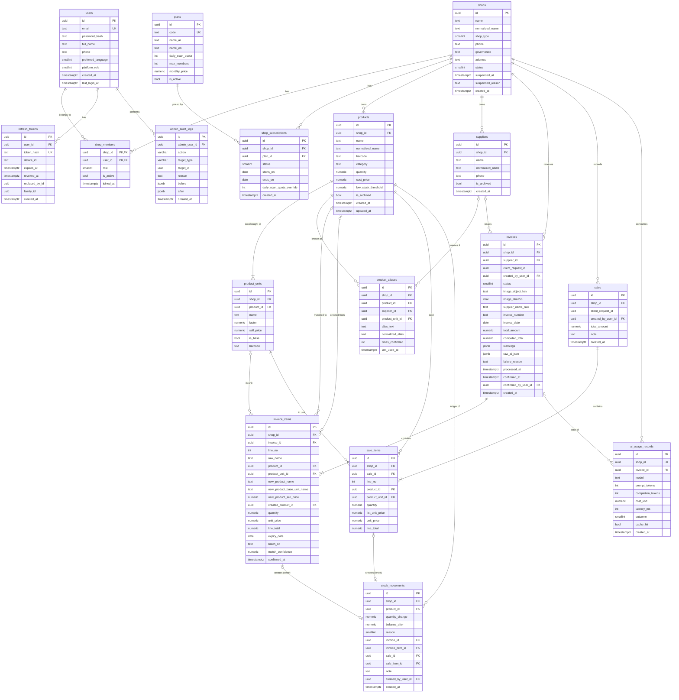

# Stockly — Entity Relationship Design (v1)

Status: **Draft for review**
Related ADRs: 0001 (stock ledger), 0002 (multi-tenancy), 0003 (units), 0004 (expiry), 0005 (platform admin), 0006 (offline idempotency), 0008 (image storage), 0009 (UUIDv7 in Domain)

## 1. Global conventions

| Concern | Decision |
|---|---|
| Naming | `snake_case` tables/columns via `EFCore.NamingConventions`. C# stays PascalCase. |
| Primary keys | `uuid`, generated in the app as **UUIDv7** (time-ordered → index-friendly inserts). The Domain `Entity` base assigns the id at construction with `Guid.CreateVersion7()` (ADR-0010). Ids from different milliseconds sort by creation time; inside one millisecond they do not, so order by `created_at`, never by `id`. |
| Time | `timestamptz`, always UTC, produced by `IClock`. Business dates (invoice date, expiry) are `date`. |
| Money | `numeric(18,2)`, C# `decimal`, never negative. Currency is EGP (one currency, no currency column). |
| Quantities | `numeric(14,3)`, always stored in the product's **base unit** (supports 1.5 kg for groceries). |
| Unit factors | `numeric(14,6)`, > 0. |
| Precision rule | Values with more decimal places than the column allows are **rejected** with a validation error, never silently rounded (`Domain/Common/Precision`). The only roundings are unit conversion (`ProductUnit.ToBase` rounds to 3 decimals) and line totals (`line_total = round(quantity × unit_price, 2)` on `invoice_items` and `sale_items`, `InvoiceItem.ComputeLineTotal`; backend.md §17.1 item 6), both `MidpointRounding.AwayFromZero`. `ai_usage_records.cost_usd` (a provider-reported USD measurement, not EGP money) is rounded to 8 decimals. |
| Concurrency | Postgres `xmin` mapped as EF concurrency token on `products`, `invoices`. |
| Tenancy | Every tenant table has `shop_id NOT NULL` + EF global query filter from `ICurrentTenant`. Child tables also carry `shop_id` (denormalized) so the filter and indexes never need a join. |
| Soft delete | Only `products` and `suppliers` (`is_archived`). Ledger tables are append-only, never deleted. |
| Enums | Stored as `smallint`, mapped to C# enums. Values never reordered, only appended. |
| Text search | `pg_trgm` extension, `normalized_*` columns built by `Domain/Text/ArabicTextNormalizer` (pure, unit-tested): tashkeel (U+064B–U+0652, U+0670) and tatweel (U+0640) removed; أ إ آ ٱ → ا, ة → ه, ى → ي; Arabic-Indic ٠-٩ and Persian ۰-۹ digits → 0-9; Latin lower-case (invariant); trimmed, whitespace collapsed to one space. Mixed scripts stay mixed (`بنادول Extra 500` → `بنادول extra 500`). |
| Schemas | `public` for app tables, `hangfire` for Hangfire. |

## 2. Diagram



## 3. Tables, constraints and indexes

Every index below exists because a named query needs it. The "Serves" column is the contract: if a query is removed, its index is reviewed too.

### 3.1 Identity & tenancy

**users** — ASP.NET Core Identity stores this (`AspNetUsers` remapped to `users`). `platform_role`: 0 = None, 1 = PlatformAdmin.

| Index / constraint | Serves |
|---|---|
| `UNIQUE (normalized_email)` (Identity column) | login |
| `(normalized_email text_pattern_ops)` (`ix_users_normalized_email_pattern`, Sprint 5) | AD4 owner email search: `AdminShopQueries.ListAsync` `EXISTS (owner member JOIN users WHERE normalized_email LIKE 'TERM%')` (under a non-C collation a btree serves `LIKE` prefixes only with pattern operators) |

**refresh_tokens** — only the SHA-256 hash of the token is stored. Rotation: each refresh revokes the old row and sets `replaced_by_id`; reuse of a revoked token revokes the whole chain (theft detection). **Token families** (step 1.5): each login or register (one device session) starts a family; `family_id uuid NOT NULL` is the id of the family's first token. Reuse revokes the whole family, including its active token; other families (other devices) of the same user are untouched.

| Index / constraint | Serves |
|---|---|
| `UNIQUE (token_hash)` | refresh |
| `(user_id) WHERE revoked_at IS NULL` | logout-all, chain revoke |
| `(family_id) WHERE revoked_at IS NULL` | family revoke on reuse detection and on logout (`RefreshTokenRepository.RevokeFamilyAsync`) |

**shops** — `shop_type`: Pharmacy, Grocery, MobileShop, Other. `status`: Active, Suspended (set by platform admin).

`normalized_name` (`text NOT NULL`, Sprint 5) is the `ArabicTextNormalizer` key of `name`, set by the Domain; migration `PlatformAdmin` backfilled existing rows with the same mapping in SQL. `suspended_at timestamptz NULL` and `suspended_reason text NULL` are set by AD6 and cleared by AD7.

| Index / constraint | Serves |
|---|---|
| `(status, created_at DESC)` (`ix_shops_status_created_at`) | AD4 with a status filter: `AdminShopQueries.ListAsync` `WHERE status = @s [AND search] ORDER BY created_at DESC, id DESC OFFSET … LIMIT …` plus the count |
| `(created_at DESC)` (`ix_shops_created_at`, Sprint 5) | AD4 without a status filter, same order |
| `GIN (normalized_name gin_trgm_ops)` (`ix_shops_normalized_name_trgm`, Sprint 5) | AD4 search on the shop name: `normalized_name ILIKE '%term%'` (term Arabic-normalized, wildcards escaped) |

**shop_members** — PK `(shop_id, user_id)`. `role`: Owner, Staff. A shop has exactly one Owner. Not a tenant table (no `shop_id` query filter): it maps users to tenants and is read at login before any tenant exists. Every query on it filters by a user id (ADR-0002, update 2026-10-12).

| Index / constraint | Serves |
|---|---|
| `(user_id) WHERE is_active` | "which shops can I switch to" at login |
| `UNIQUE (shop_id) WHERE role = Owner` (partial) | one owner per shop |

**plans / shop_subscriptions** — the effective daily scan quota comes from the active subscription's plan.

| Index / constraint | Serves |
|---|---|
| `plans UNIQUE (code)` | seed / lookup |
| `shop_subscriptions UNIQUE (shop_id) WHERE status = Active` | one active subscription per shop; the scan's effective quota `ShopPlanQueries.GetDailyScanQuotaAsync` (`COALESCE(daily_scan_quota_override, plan.daily_scan_quota)`); the admin's reads of the active subscription (AD4 plan code, AD5, AD8, AD9: `AdminShopQueries.FindSubscriptionAsync`, `AdminShopRepository.FindActiveSubscriptionAsync`, without the tenant filter) |
| `shop_subscriptions CHECK (daily_scan_quota_override IS NULL OR daily_scan_quota_override BETWEEN 0 AND 10000)` (`ck_shop_subscriptions_daily_scan_quota_override`, Sprint 5) | AD9 range |
| `shop_subscriptions (ends_on) WHERE status = Active` | expiry job |

Implementation notes for the identity and tenancy tables (migration `Identity`, step 1.5):
- Index names: `ux_users_normalized_email`, `ux_refresh_tokens_token_hash`, `ix_refresh_tokens_user_id_active`, `ix_refresh_tokens_family_id_active`, `ix_shop_members_user_id_active`, `ux_shop_members_shop_id_owner` (`WHERE role = 1`), `ux_plans_code`, `ux_shop_subscriptions_shop_id_active` and `ix_shop_subscriptions_ends_on_active` (`WHERE status = 1`). Enums are smallint: `shop_members.role` Owner 1 / Staff 2; `shop_subscriptions.status` Active 1 / Ended 2; `users.preferred_language` Ar 1 / En 2; `users.platform_role` None 0 / PlatformAdmin 1.
- `users` also has Identity's own columns (`user_name`, `normalized_user_name`, `email`, `password_hash`, `security_stamp`, `concurrency_stamp`, lockout and two-factor flags) and its `UNIQUE (normalized_user_name)` index (`ux_users_normalized_user_name`), required by Identity; the user name is the email. Identity's `PhoneNumber` is mapped to the `phone` column. Identity's `user_claims`, `user_logins`, `user_tokens` tables exist (Identity's user store); there are no roles tables.
- `refresh_tokens.token_hash` is the lower-case hex SHA-256 of the token. `refresh_tokens.user_id` → `users` is `ON DELETE CASCADE`; `replaced_by_id` is a plain column (no FK). The partial `(user_id)` and `(family_id)` indexes also back the FK and the family revoke.
- `shop_members` FKs: `shop_id` → `shops` (covered by the PK), `user_id` → `users` (covered by the partial index); both restrict.
- `shop_subscriptions.plan_id` → `plans` gets the EF-created `ix_shop_subscriptions_plan_id` (FK support; not used by a named query). `starts_on`/`ends_on` are `date` (Cairo business dates); `ends_on` NULL = open-ended.
- `shop_subscriptions.daily_scan_quota_override int NULL` (Sprint 5, AD9): the platform admin's per-shop quota; `NULL` uses the plan's. AD8 copies it to the new subscription. AD8 inserts the new subscription with an explicit statement in `Infrastructure/Persistence/Admin` (an admin request has no tenant for the tenant stamp), after saving the ended one.
- `shop_members` by shop id (ADR-0002 update 2026-10-18): only the platform admin's reads in `Infrastructure/Persistence/Admin` filter by `shop_id` (AD4 owner, AD5 members, AD6 token revocation through `ix_refresh_tokens_user_id_active`); the primary key `(shop_id, user_id)` serves them.
- `plans` is seeded with the default plan (`Domain/Shops/DefaultPlan.cs`): `standard`, 30 scans/day, 3 members, 0.00 EGP, active (product-owner assumption, `docs/features/auth.md`).
- `ix_stock_movements_created_by_user_id` is created by EF to support the now-real FK `stock_movements.created_by_user_id` → `users` (restrict). It is not used by a named query.

### 3.2 Catalog

**products** — `quantity` is a **projection** of `stock_movements` (ADR-0001). It is written only by `IStockService` inside the same transaction as the movement. `cost_price` is per base unit.

`low_stock_threshold` is `numeric(14,3) NOT NULL DEFAULT 0`, in base units. With the default 0, a product is low when `quantity <= 0`, so out-of-stock products always appear in the low-stock list. This is intended.

`barcode` (`text NULL`, max 64) and `category` (`text NULL`, max 100) are trimmed; blank is stored as NULL (step 1.6).

| Index / constraint | Serves |
|---|---|
| `CHECK (low_stock_threshold >= 0)` | data integrity |
| `UNIQUE (shop_id, barcode) WHERE barcode IS NOT NULL AND NOT is_archived` (`ux_products_shop_id_barcode`) | P3/P4 duplicate check `ProductRepository.IsBarcodeUsedAsync`: `WHERE shop_id = @shop AND barcode = @b AND NOT is_archived AND id <> @self`; P12 barcode lookup `ProductQueries.FindByBarcodeAsync` (product barcode, after the unit barcode): `WHERE shop_id = @shop AND barcode = @b AND NOT is_archived` (Sprint 4) |
| `(shop_id, normalized_name) WHERE NOT is_archived` (`ix_products_shop_id_normalized_name`) | D1 `productCount` (`DashboardQueries.GetCountsAsync`: `WHERE shop_id = @shop AND NOT is_archived`, count, Sprint 4); P1 `GetProductsQuery`: `WHERE shop_id = @shop AND NOT is_archived ORDER BY normalized_name, id OFFSET … LIMIT …` (product list sorted by name, paging); matching v1 `ExactNameMatchStrategy` → `ProductRepository.FindByNormalizedNamesAsync`: `WHERE shop_id = @shop AND normalized_name = ANY(@names) AND NOT is_archived`, one statement for all lines of an invoice, units joined in the same statement (step 2b) |
| `GIN (normalized_name gin_trgm_ops)` (`ix_products_normalized_name_trgm`) | P1 `search`: `normalized_name ILIKE '%' \|\| @term \|\| '%' ESCAPE '\'` (wildcards in the term escaped), the term Arabic-normalized first; fuzzy match (Sprint 6) |
| `(shop_id) WHERE quantity <= low_stock_threshold AND NOT is_archived` (`ix_products_low_stock`) | P1 `lowStock=true` → `GetLowStockQuery`: `WHERE shop_id = @shop AND quantity <= low_stock_threshold AND NOT is_archived ORDER BY normalized_name, id` — tiny partial index, only low items live in it; D1 `lowStockCount` (same predicate, count) and `negativeStockCount` (`… AND quantity < 0`: the index predicate is repeated so the partial index applies; thresholds are >= 0, so a negative product is always low) (Sprint 4) |
| primary key | P2/P4–P10 load by id; `StockService` row lock `SELECT 1 FROM products WHERE id = @id AND shop_id = @shop FOR UPDATE`; confirm and sale lock all their products in one statement, `StockService.LockProductsAsync`: `SELECT 1 FROM products WHERE id = ANY(@ids) AND shop_id = @shop ORDER BY id FOR UPDATE` (rule 4, Sprint 4); D2 product of a line (join on `COALESCE(product_id, created_product_id)`); I4 product checks `ProductRepository.FindUnitsInfoAsync` (`WHERE shop_id = @shop AND id = ANY(@ids)`, units in the same statement); I3 product name of a line (`InvoiceQueries.FindDetailAsync`) |

Quantity is allowed to go negative (a sale recorded before the invoice was scanned is real life). Negative stock raises a warning on the dashboard, it does not block the cashier.

**product_units** — `factor` (`numeric(14,6)`) = how many base units are in one of this unit. Example Panadol: `Strip` factor 1 (base), `Box` factor 3. Groceries: `Kg` factor 1, `Sack 25kg` factor 25. The base unit should be the **smallest** unit sold, so most factors are >= 1; fractional factors (e.g. `Half kg` = 0.5) are allowed. Conversion: `ToBase(q) = round(q × factor, 3, away from zero)`. Unit names are unique per product after normalization (the Domain checks this; the DB index below is on the raw name).

| Index / constraint | Serves |
|---|---|
| `CHECK (factor > 0)` | integrity |
| `UNIQUE (product_id, name)` | no duplicate unit names |
| `UNIQUE (product_id) WHERE is_base` | exactly one base unit |
| `(product_id)` covered by the unique above | load units with product (P2 detail, every product edit; matching and the I4 checks, step 2b) |
| primary key | I4 `ProductRepository.UnitExistsAsync` (`WHERE shop_id = @shop AND id = @unit`, only when a unit is not one of the line's product; also S1 for a unit that is not the line product's); I3 and S1/S3 unit name of a line; D2 unit factor of a line |
| `UNIQUE (shop_id, barcode) WHERE barcode IS NOT NULL` | a box and a strip can have different barcodes; P6/P7 duplicate check `ProductRepository.IsUnitBarcodeUsedAsync`: `WHERE shop_id = @shop AND barcode = @b AND id <> @self` (archived products' units included); P12 barcode lookup (unit barcode first): `WHERE shop_id = @shop AND barcode = @b`, joined to the non-archived product by primary key (Sprint 4) |

**product_aliases** — learned on every invoice confirmation: "the supplier wrote X, the user mapped it to product P in unit U". Next scan from the same supplier auto-matches with confidence 1.0. `product_unit_id` is `NOT NULL` (aliases are learned only from confirmed lines, which always have a unit); `times_confirmed integer NOT NULL DEFAULT 1`.

| Index / constraint | Serves |
|---|---|
| `UNIQUE NULLS NOT DISTINCT (shop_id, supplier_id, normalized_alias)` (PG 15+, `ux_product_aliases_shop_id_supplier_id_normalized_alias`) | matching v1 `ExactAliasMatchStrategy` → `ProductAliasRepository.FindExactAsync`: `WHERE shop_id = @shop AND supplier_id = @supplier` (`supplier_id IS NULL` when the invoice supplier is unknown) `AND normalized_alias = ANY(@names)`, joined to `products` by primary key `AND NOT is_archived`; one statement for all lines (step 2b); arbiter of the confirm upsert `ProductAliasRepository.UpsertAsync`: one `INSERT … SELECT … FROM unnest(…) ON CONFLICT (shop_id, supplier_id, normalized_alias) DO UPDATE SET product_id, product_unit_id, times_confirmed = times_confirmed + EXCLUDED.times_confirmed, last_used_at` (Sprint 4) |
| `GIN (normalized_alias gin_trgm_ops)` (`ix_product_aliases_normalized_alias_trgm`) | fuzzy match fallback |
| `CHECK (times_confirmed > 0)` (`ck_product_aliases_times_confirmed`) | integrity (backend.md §17.1 item 15) |

**suppliers**

| Index / constraint | Serves |
|---|---|
| `UNIQUE (shop_id, normalized_name) WHERE NOT is_archived` (`ux_suppliers_shop_id_normalized_name`) | `SupplierRepository.FindIdByNormalizedNameAsync` (scan job: `WHERE shop_id = @shop AND normalized_name = @n AND NOT is_archived`); dedupe on confirm, `SupplierRepository.FindOrCreateAsync`: `INSERT … ON CONFLICT (shop_id, normalized_name) WHERE NOT is_archived DO NOTHING`, then the select above (Sprint 4) |
| `GIN (normalized_name gin_trgm_ops)` (`ix_suppliers_normalized_name_trgm`) | supplier fuzzy match |

### 3.3 Invoices

**invoices** — `status`: Processing, NeedsReview, Confirmed, Failed. `raw_ai_json` keeps the untrusted model output for audit/debug. `warnings` is a list of codes (`TotalMismatch`, `ItemCapExceeded`, `UnreadableLines`, `DuplicateInvoiceNumber`).

| Index / constraint | Serves |
|---|---|
| `UNIQUE (shop_id, client_request_id)` (`ux_invoices_shop_id_client_request_id`) | offline queue retries never create two invoices (ADR-0006): `InvoiceQueries.FindListItemByClientRequestIdAsync` (`WHERE shop_id = @shop AND client_request_id = @id`); a concurrent repeat loses on this index and gets the winner |
| `(shop_id, created_at DESC)` (`ix_invoices_shop_id_created_at`) | invoice history list I2 without a status, `InvoiceQueries.ListAsync` (`WHERE shop_id = @shop ORDER BY created_at DESC OFFSET … LIMIT …`, plus `count(*)` with the same filter; `itemCount` is a correlated count in the page statement); daily scan quota fallback count when Redis is down: `InvoiceRepository.CountCreatedSinceAsync` (`WHERE shop_id = @shop AND created_at >= @cairoDayStart`, `docs/design/redis.md` §4) |
| `(shop_id, status, created_at DESC)` (`ix_invoices_shop_id_status_created_at`) | I2 with a status filter, newest first, `InvoiceQueries.ListAsync` (`WHERE shop_id = @shop AND status = @status ORDER BY created_at DESC OFFSET … LIMIT …`, plus the count); "waiting for review" badge, D1 `invoicesAwaitingReview` (`WHERE shop_id = @shop AND status = 2`, count, Sprint 4). Replaces the planned partial `(shop_id, status) WHERE status IN (1, 2)` (backend.md §17.1 item 4) |
| `(shop_id, image_sha256)` (`ix_invoices_shop_id_image_sha256`) | duplicate photo detection, DB side of the AI cache: `InvoiceRepository.FindReusableExtractionAsync` (`WHERE shop_id = @shop AND image_sha256 = @sha AND id <> @self AND status IN (2, 3) AND raw_ai_json IS NOT NULL ORDER BY created_at DESC LIMIT 1`) |
| `(shop_id, supplier_id, invoice_number) WHERE invoice_number IS NOT NULL` (`ix_invoices_shop_id_supplier_id_invoice_number`) | duplicate invoice warning: `InvoiceRepository.ExistsOtherWithNumberAsync` (`WHERE shop_id = @shop AND invoice_number = @n AND supplier_id IS NOT DISTINCT FROM @supplier AND id <> @self AND status <> 4`) |
| `(status, created_at DESC) WHERE status = Failed` (`ix_invoices_status_created_at_failed`) | AD17 failed scans of every shop: `AdminInvoiceQueries.ListFailedAsync` `WHERE status = 4 ORDER BY created_at DESC, id DESC OFFSET … LIMIT …` plus the count (with `shopId`: `ix_invoices_shop_id_status_created_at`). AD4/AD5 `scansToday` (`WHERE shop_id = @shop AND created_at >= @cairoMidnight`) uses `ix_invoices_shop_id_created_at` |
| primary key | the job's lookup (`FindProcessingInfoAsync`) and the row lock `SELECT 1 FROM invoices WHERE id = @id AND shop_id = @shop FOR UPDATE` (`InvoiceRepository.FindForUpdateAsync`, also the I4 lock and step 1 of the I5 confirm, Sprint 4); I3 `InvoiceQueries.FindDetailAsync` (one statement with the lines and their product/unit names) |
| `CHECK (confirmed_at IS NULL OR status = Confirmed)` (`ck_invoices_confirmed_at`) | integrity |

Other column details (migration `InvoiceScan`): `image_sha256 character(64)` (lower-case hex), `warnings jsonb NOT NULL DEFAULT '[]'` (array of warning names, e.g. `["TotalMismatch"]`), `raw_ai_json jsonb NULL` (model output that is not JSON is stored as a JSON string literal; at most 256 KB), `failure_reason text NULL` (`ImageMissing`, `AiUnavailable`, `AiOutputInvalid`, `AiNoItems`, `Unexpected`), `status smallint` (Processing 1, NeedsReview 2, Confirmed 3, Failed 4).

**invoice_items** — a line either references an **existing** product (`product_id` + `product_unit_id`) or describes a **new** one (`new_product_name`, `new_product_base_unit_name`, `new_product_sell_price numeric(18,2)`, contract v1.1 I4 `newProduct`; cost price = the line's `unit_price`, `quantity` in the new base unit). Never both; a confirmed line never has neither. Lines straight from the AI (`NeedsReview`) may have neither (unmatched). Two supporting columns make the rule enforceable in the row (design: `docs/design/backend.md` §10):
- `confirmed_at timestamptz NULL`: set on every line, in the confirm transaction, to the invoice's `confirmed_at` (a CHECK cannot read `invoices.status`).
- `created_product_id uuid NULL` FK `products`: the product created from `new_product_*` on confirm. `product_id` stays NULL on such a line, so "never both" holds after confirm too. Queries that need "the line's product" use `COALESCE(product_id, created_product_id)`.

Other types: `quantity numeric(14,3)` (in the line's unit), `unit_price`/`line_total numeric(18,2)`, `match_confidence numeric(3,2)`. `expiry_date`/`batch_no` are informational in v1 (ADR-0004). Lines are replaced (deleted and re-inserted) only by the review edit while the invoice is `NeedsReview`.

| Index / constraint | Serves |
|---|---|
| `UNIQUE (invoice_id, line_no)` (`ux_invoice_items_invoice_id_line_no`) | ordered review screen, stable edits; loading the lines of an invoice (`FindForUpdateAsync`, I3 lines `ORDER BY line_no`, the item count of I2 and `FindListItemByClientRequestIdAsync`); FK support for `invoice_id`. I4 deletes the old rows and inserts the new ones in one save (EF orders the deletes first, so reused line numbers do not collide) |
| `(shop_id, product_id)` | product purchase history |
| `(created_product_id) WHERE created_product_id IS NOT NULL` | product purchase history for products created from an invoice (`product_id = @p OR created_product_id = @p`); FK support |
| `(shop_id, expiry_date) WHERE expiry_date IS NOT NULL` (`ix_invoice_items_shop_id_expiry_date`) | D1 `expiringSoonCount` and D2 `DashboardQueries.ListExpiringAsync` (Sprint 4): `WHERE shop_id = @shop AND confirmed_at IS NOT NULL AND expiry_date <= @until`, joined to `products` on `COALESCE(product_id, created_product_id)` `AND NOT is_archived AND quantity > 0`, `ORDER BY expiry_date, product name, id OFFSET … LIMIT …` plus the count |
| `CHECK (quantity > 0 AND unit_price >= 0 AND line_total >= 0)` | integrity |
| `CHECK (line_no BETWEEN 1 AND 100)` | 100-line cap (AGENTS.md rule 15, contract I4) |
| `CHECK (match_confidence IS NULL OR match_confidence BETWEEN 0 AND 1)` | contract confidence range |
| `CHECK (product_id IS NULL OR new_product_name IS NULL)` | **never both** existing and new product |
| `CHECK (num_nonnulls(new_product_name, new_product_base_unit_name, new_product_sell_price) IN (0, 3))` | a new product is fully described or absent |
| `CHECK (new_product_sell_price IS NULL OR new_product_sell_price >= 0)` | money never negative |
| `CHECK ((product_id IS NULL) = (product_unit_id IS NULL))` | an existing product always comes with its unit |
| `CHECK (confirmed_at IS NULL OR num_nonnulls(product_id, new_product_name) = 1)` | a **confirmed** line **never has neither** |
| `CHECK ((created_product_id IS NOT NULL) = (new_product_name IS NOT NULL AND confirmed_at IS NOT NULL))` | the created product exists exactly for confirmed new-product lines |

"`product_unit_id` is a unit of `product_id`" and "`confirmed_at` is set on every line exactly when the invoice is confirmed" cannot be CHECKs (they span rows/tables); the Domain (`Invoice`) enforces them and Infrastructure tests assert them.

### 3.4 Sales

**sales / sale_items** — quick-sale screen. Same idempotency pattern as invoices.

`sale_items.list_unit_price` (`numeric(18,2) NOT NULL`) is the unit's sell price at sale time; `unit_price` (`numeric(18,2) NOT NULL`) is the price charged; `line_total = round(quantity × unit_price, 2)` (§1). A line is "price overridden" when they differ (contract v1.1, S1/D1). `quantity numeric(14,3)` is in the line's unit; the movement holds the base-unit change. `sale_items.line_no int` (1..100) keeps request order (UUIDv7 ids do not order inside one millisecond; Sprint 4 addition). `sales.total_amount numeric(18,2)` = sum of line totals; `sales.note text NULL` (max 500). Migration `Sales` (Sprint 4), `docs/features/sales.md`.

Concurrency (AGENTS.md rules 3, 4): S1 inserts the sale header first; a concurrent request with the same `client_request_id` blocks on the unique index until the first commits, then loses and returns the existing sale. Then the products are locked with the same ordered statement as confirm (§3.2 primary key).

| Index / constraint | Serves |
|---|---|
| `sales UNIQUE (shop_id, client_request_id)` (`ux_sales_shop_id_client_request_id`) | double-tap / retry safety (ADR-0006): `SaleQueries.FindByClientRequestIdAsync` (`WHERE shop_id = @shop AND client_request_id = @id`); serializes concurrent repeats |
| `sales (shop_id, created_at DESC)` (`ix_sales_shop_id_created_at`) | S2 `SaleQueries.ListAsync`: `WHERE shop_id = @shop [AND created_at >= @from] [AND created_at < @to] ORDER BY created_at DESC, id DESC OFFSET … LIMIT …` plus the count; D1 today's sales `WHERE shop_id = @shop AND created_at >= @cairoDayStart AND created_at < @nextCairoDayStart` (count, sum, overridden count) |
| `sale_items UNIQUE (sale_id, line_no)` (`ux_sale_items_sale_id_line_no`) | load a sale's lines in order (S1 response, S3); S2 item count (correlated count); D1 "has an overridden line"; FK support for `sale_id`. Replaces the planned plain `sale_items (sale_id)` |
| `sale_items (shop_id, product_id)` (`ix_sale_items_shop_id_product_id`) | top sellers (no endpoint yet) |
| `sales CHECK (total_amount >= 0)` (`ck_sales_total_amount`) | integrity |
| `sale_items CHECK (quantity > 0 AND list_unit_price >= 0 AND unit_price >= 0 AND line_total >= 0)` (`ck_sale_items_amounts`) | integrity |
| `sale_items CHECK (line_no BETWEEN 1 AND 100)` (`ck_sale_items_line_no`) | 100-line cap (contract S1) |

FK-support indexes created by EF (no named query): `ix_sales_created_by_user_id`, `ix_sale_items_product_id` (also `ProductUnit.InUse` once implemented), `ix_sale_items_product_unit_id`, `ix_stock_movements_sale_id`.

### 3.5 Stock ledger

**stock_movements** — append-only. `reason`: InvoiceReceipt (1), Sale (2), ManualAdjustment (3), StockCount (4), InvoiceReversal (5). `quantity_change` is in base units, `balance_after` is the product quantity right after this row (makes history screens and audits trivial).

Rules per reason (enforced in `Domain/Stock/StockMovement`; created only through `Product.RecordMovement`):

| Reason | Source | Change |
|---|---|---|
| InvoiceReceipt | `invoice_id` + `invoice_item_id` | > 0 |
| Sale | `sale_id` + `sale_item_id` | < 0 |
| ManualAdjustment | none; `note` required | ≠ 0 |
| StockCount | none (`change = counted − current`; no movement when equal) | ≠ 0 |
| InvoiceReversal | `invoice_id` + `invoice_item_id` | < 0 |

**A reversal is terminal.** A reversed invoice line can never be received again; corrections go through a new scan or a manual adjustment. This is why `UNIQUE (invoice_item_id, reason)` is sufficient: each line has at most one receipt and at most one reversal. Matching the reversal amount to the original receipt is an Application rule (the aggregate cannot see the receipt).

| Index / constraint | Serves |
|---|---|
| `UNIQUE (invoice_item_id, reason) WHERE invoice_item_id IS NOT NULL` | **idempotent confirm** — the DB refuses a second receipt for the same line; also allows exactly one (terminal) reversal per line |
| `UNIQUE (sale_item_id) WHERE sale_item_id IS NOT NULL` | idempotent sale; a sale line's `balance_after` in `SaleQueries` (`WHERE sale_item_id = @line`, Sprint 4) |
| `(shop_id, product_id, created_at DESC)` | product movement history: P11 `WHERE shop_id = @shop AND product_id = @p ORDER BY created_at DESC, id DESC OFFSET … LIMIT …` and its `COUNT` |
| `(shop_id, created_at DESC)` | dashboard activity feed |
| `CHECK (quantity_change <> 0)` | no empty movements |
| `CHECK (num_nonnulls(invoice_item_id, sale_item_id) <= 1)` | a movement has one source |

> Why `invoice_item_id` and not `(invoice_id, product_id)` as the prompt suggested: one invoice can list the same product twice (two batches, two prices). A unique key on `(invoice_id, product_id)` would reject a valid invoice. One movement per **line** is the correct grain.

### 3.6 Platform

**ai_usage_records** — one row per OpenRouter call (including retries and cache hits with cost 0). Feeds the admin cost dashboard and the per-shop quota fallback when Redis is down.

| Index / constraint | Serves |
|---|---|
| `(shop_id, created_at DESC)` (`ix_ai_usage_records_shop_id_created_at`) | per-shop usage and cost in admin: AD14 with `shopId` (`WHERE created_at >= @from AND created_at < @to AND shop_id = @shop GROUP BY (created_at AT TIME ZONE 'Africa/Cairo')::date`), AD5 `aiCostLast30DaysUsd` (`WHERE shop_id = @shop AND created_at >= now - 30 days`, sum) |
| `(created_at DESC)` (`ix_ai_usage_records_created_at`) | platform-wide cost chart: AD14 without a shop (grouped by Cairo day), AD15 (`GROUP BY shop_id` joined to `shops`, `ORDER BY sum(cost_usd) DESC, shop_id LIMIT … OFFSET …` plus `count(DISTINCT shop_id)`), AD16 (`GROUP BY model ORDER BY sum(cost_usd) DESC, model`); all `WHERE created_at >= @from AND created_at < @to` (Cairo-day bounds in UTC) |
| `(invoice_id)` (`ix_ai_usage_records_invoice_id`) | invoice detail in admin (AD18 usage rows, oldest first; AD17 `attempts` = count of rows that are not cache hits); the model of an earlier extraction (`FindReusableExtractionAsync` subquery `WHERE invoice_id = @earlier AND outcome = 1 ORDER BY created_at DESC LIMIT 1`) |
| `CHECK (prompt_tokens >= 0 AND completion_tokens >= 0 AND cost_usd >= 0 AND latency_ms >= 0)` (`ck_ai_usage_records_non_negative`) | integrity (backend.md §17.1 item 15) |

Columns: `cost_usd numeric(14,8)` (USD credits, not EGP money), `outcome smallint` (Succeeded 1, InvalidOutput 2, RateLimited 3, ServerError 4, ClientError 5, Timeout 6, NetworkError 7, Cancelled 8), `cache_hit boolean` (database reuse or Redis AI cache: 0 tokens, cost 0).

Growth note: when this table passes ~10M rows, partition by month on `created_at` (not needed for v1).

**admin_audit_logs** — every PlatformAdmin write (AD6–AD10, AD12, AD13, AD19), in the same transaction as the write; idempotent repeats write none. No tenant filter by design (ADR-0005). Columns (migration `PlatformAdmin`, Sprint 5): `admin_user_id uuid` FK `users` (restrict, `fk_admin_audit_logs_users_admin_user_id`), `action varchar(64)` (e.g. `Shop.Suspend`), `target_type varchar(64)` (`Shop`, `Plan`, `Invoice`), `target_id uuid`, `reason text NULL`, `before jsonb NULL`, `after jsonb NULL` (camelCase objects of the changed fields), `created_at`. Replaces the draft's single `payload` column (contract §11.1).

| Index / constraint | Serves |
|---|---|
| `(target_type, target_id, created_at DESC)` (`ix_admin_audit_logs_target_type_target_id_created_at`) | "history of this shop": AD20 `WHERE target_type = @t [AND target_id = @id] ORDER BY created_at DESC, id DESC` plus the count (a `targetType`-only filter uses its prefix) |
| `(admin_user_id, created_at DESC)` (`ix_admin_audit_logs_admin_user_id_created_at`) | "what did this admin do": AD20 `WHERE admin_user_id = @a ORDER BY created_at DESC`; FK support |
| `(created_at DESC)` (`ix_admin_audit_logs_created_at`) | AD20 without filters, newest first |

### 3.7 Migration status (what exists in the database today)

| Migration | Tables | Notes |
|---|---|---|
| `InitialCatalog` (step 1.4a) | `shops`, `products`, `product_units`, `stock_movements` | `pg_trgm`; every index and check listed above for these tables |
| `Identity` (step 1.5) | `users`, `user_claims`, `user_logins`, `user_tokens`, `refresh_tokens`, `shop_members`, `plans`, `shop_subscriptions` | every index and constraint listed in §3.1 (including `refresh_tokens.family_id` and its index); default plan seeded; FK `stock_movements.created_by_user_id` → `users` added |
| `ProductsCatalog` (step 1.6) | — | `products.barcode text NULL`, `products.category text NULL`, `UNIQUE (shop_id, barcode) WHERE barcode IS NOT NULL AND NOT is_archived` (`ux_products_shop_id_barcode`) |
| `Sales` (Sprint 4) | `sales`, `sale_items` | every index and check listed in §3.4; FKs `stock_movements.sale_id` → `sales`, `stock_movements.sale_item_id` → `sale_items` (restrict). Confirm, P12 and the dashboard add no index (their queries are listed next to existing indexes above) |
| `PlatformAdmin` (Sprint 5, step 5a) | `admin_audit_logs` | `shops.normalized_name` (backfilled), `shops.suspended_at`, `shops.suspended_reason`, `shop_subscriptions.daily_scan_quota_override` with its CHECK; indexes `ix_shops_created_at`, `ix_shops_normalized_name_trgm`, `ix_users_normalized_email_pattern` and the three `admin_audit_logs` indexes (§3.1, §3.6). Docs: `docs/features/admin.md` |
| `InvoiceScan` (Sprint 2, step 2a) | `suppliers`, `product_aliases`, `invoices`, `invoice_items`, `ai_usage_records`; schema `hangfire` | every index and check listed above for these tables; FKs `stock_movements.invoice_id` → `invoices`, `stock_movements.invoice_item_id` → `invoice_items` (restrict); Hangfire tables are created in schema `hangfire` by `Hangfire.PostgreSql` at startup (backend.md §17.1 item 8, documented exception to rule 31). Design: `docs/design/backend.md` §12 |

Step 2b (matching, I2–I4) adds no migration: every filter and sort it uses is served by an index of `InitialCatalog` or `InvoiceScan` (the queries are listed next to those indexes above).

Implementation notes for the `InitialCatalog` tables:
- `products.updated_at` is an EF **shadow property** set by `AuditTimestampsInterceptor` from `IClock`; the Domain type has no such property.
- `products` uses PostgreSQL's system column `xmin` as the optimistic concurrency token (shadow property, `IsRowVersion`); no column is created.
- `ix_stock_movements_product_id` is created by EF to support the `product_id` foreign key (no listed index starts with `product_id`). It is not used by a named query.
- The EF history table is `__ef_migrations_history` (pinned explicitly so `dotnet ef` and the app agree).
- All `timestamptz` values must be UTC (offset zero); Npgsql rejects other offsets. `IClock.UtcNow` guarantees it.

**Deferred foreign keys.** These columns exist now as plain columns; the FK constraint is added by the migration that creates the target table.

| Column | Null | Target | Added in |
|---|---|---|---|
| `stock_movements.created_by_user_id` | NOT NULL | `users` | 1.5 (**done**, migration `Identity`) |
| `stock_movements.invoice_id` | NULL | `invoices` | Sprint 2 (**done**, migration `InvoiceScan`) |
| `stock_movements.invoice_item_id` | NULL | `invoice_items` | Sprint 2 (**done**, migration `InvoiceScan`) |
| `stock_movements.sale_id` | NULL | `sales` | Sprint 4 (**done**, migration `Sales`) |
| `stock_movements.sale_item_id` | NULL | `sale_items` | Sprint 4 (**done**, migration `Sales`) |

**FK-support indexes of `InvoiceScan`.** EF creates a plain index for every foreign key that no listed index starts with; none serves a named query: `ix_invoices_supplier_id`, `ix_invoices_created_by_user_id`, `ix_invoices_confirmed_by_user_id`, `ix_invoice_items_product_id`, `ix_invoice_items_product_unit_id` (also serves `ProductUnit.InUse`, P8, once invoice lines reference units), `ix_product_aliases_product_id`, `ix_product_aliases_supplier_id`, `ix_product_aliases_product_unit_id`, `ix_stock_movements_invoice_id`.

**Deferred columns and index:** `products.barcode`, `products.category` and `UNIQUE (shop_id, barcode) WHERE barcode IS NOT NULL AND NOT is_archived` were added in step 1.6 (**done**, migration `ProductsCatalog`).

## 4. Confirm-invoice transaction (how the schema enforces rules 3 and 4)

```
BEGIN (READ COMMITTED)
  SELECT invoice ... WHERE id = @id AND shop_id = @tenant FOR UPDATE   -- serialize confirms
  if status = Confirmed → COMMIT, return existing result (idempotent)
  find or create the supplier (INSERT ... ON CONFLICT DO NOTHING, then SELECT)
  SELECT 1 FROM products WHERE id = ANY(@ids) ORDER BY id FOR UPDATE  -- one statement, fresh quantities, never from cache
  create the new products + base units (new rows need no lock)
  for each line by line_no:
     INSERT stock_movement(invoice_item_id = line.id, ...)            -- unique index = last safety net
     UPDATE product SET quantity = balance_after
  UPDATE invoice SET status = Confirmed, confirmed_at = now; every line's confirmed_at / created_product_id
  UPSERT product_aliases (one statement, after the products exist)
COMMIT
→ after commit: INCR stockly:{shopId}:ver:catalog (product lists, low stock, dashboard), status cache, supplier list
(Implemented in Sprint 4: docs/design/backend.md §11, docs/features/confirm-invoice.md. A sale follows the same
pattern with the sale header insert in place of the invoice lock: docs/features/sales.md.)
```

Lock order is always invoice → products ordered by `id`, so two concurrent operations cannot deadlock.

## 5. Assumptions

Plans and role permissions follow the assumptions listed at the end of `docs/roadmap.md` (one plan at launch; Owner and Staff can confirm, only Owner adjusts stock).
