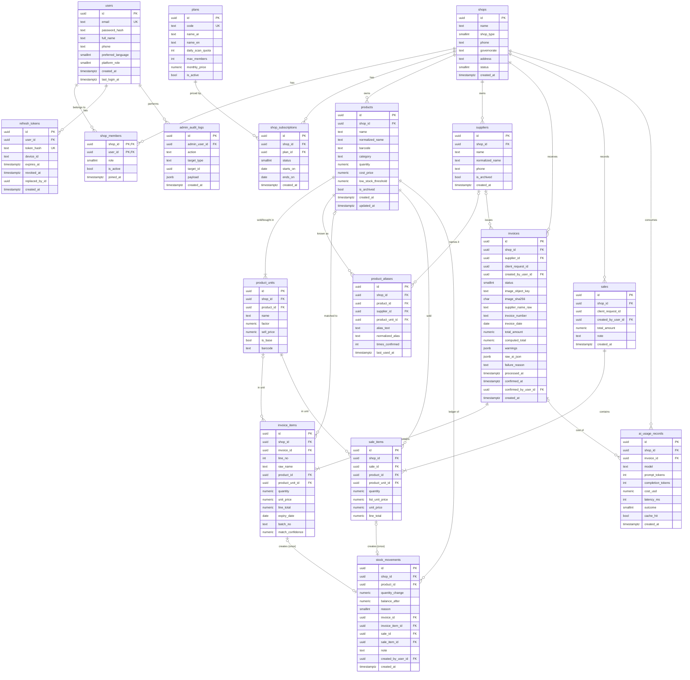

# Stockly — Entity Relationship Design (v1)

Status: **Draft for review**
Related ADRs: 0001 (stock ledger), 0002 (multi-tenancy), 0003 (units), 0004 (expiry), 0005 (platform admin), 0006 (offline idempotency), 0008 (image storage), 0009 (UUIDv7 in Domain)

## 1. Global conventions

| Concern | Decision |
|---|---|
| Naming | `snake_case` tables/columns via `EFCore.NamingConventions`. C# stays PascalCase. |
| Primary keys | `uuid`, generated in the app as **UUIDv7** (time-ordered → index-friendly inserts). The Domain `Entity` base assigns the id at construction with `Guid.CreateVersion7()` (ADR-0010). Ids from different milliseconds sort by creation time; inside one millisecond they do not, so order by `created_at`, never by `id`. |
| Time | `timestamptz`, always UTC, produced by `IClock`. Business dates (invoice date, expiry) are `date`. |
| Money | `numeric(18,2)`, C# `decimal`, never negative. Currency is EGP (one currency, no currency column). |
| Quantities | `numeric(14,3)`, always stored in the product's **base unit** (supports 1.5 kg for groceries). |
| Unit factors | `numeric(14,6)`, > 0. |
| Precision rule | Values with more decimal places than the column allows are **rejected** with a validation error, never silently rounded (`Domain/Common/Precision`). The only rounding is unit conversion: `ProductUnit.ToBase` rounds to 3 decimals, `MidpointRounding.AwayFromZero`. |
| Concurrency | Postgres `xmin` mapped as EF concurrency token on `products`, `invoices`. |
| Tenancy | Every tenant table has `shop_id NOT NULL` + EF global query filter from `ICurrentTenant`. Child tables also carry `shop_id` (denormalized) so the filter and indexes never need a join. |
| Soft delete | Only `products` and `suppliers` (`is_archived`). Ledger tables are append-only, never deleted. |
| Enums | Stored as `smallint`, mapped to C# enums. Values never reordered, only appended. |
| Text search | `pg_trgm` extension, `normalized_*` columns built by `Domain/Text/ArabicTextNormalizer` (pure, unit-tested): tashkeel (U+064B–U+0652, U+0670) and tatweel (U+0640) removed; أ إ آ ٱ → ا, ة → ه, ى → ي; Arabic-Indic ٠-٩ and Persian ۰-۹ digits → 0-9; Latin lower-case (invariant); trimmed, whitespace collapsed to one space. Mixed scripts stay mixed (`بنادول Extra 500` → `بنادول extra 500`). |
| Schemas | `public` for app tables, `hangfire` for Hangfire. |

## 2. Diagram



## 3. Tables, constraints and indexes

Every index below exists because a named query needs it. The "Serves" column is the contract: if a query is removed, its index is reviewed too.

### 3.1 Identity & tenancy

**users** — ASP.NET Core Identity stores this (`AspNetUsers` remapped to `users`). `platform_role`: 0 = None, 1 = PlatformAdmin.

| Index / constraint | Serves |
|---|---|
| `UNIQUE (normalized_email)` (Identity column) | login |

**refresh_tokens** — only the SHA-256 hash of the token is stored. Rotation: each refresh revokes the old row and sets `replaced_by_id`; reuse of a revoked token revokes the whole chain (theft detection).

| Index / constraint | Serves |
|---|---|
| `UNIQUE (token_hash)` | refresh |
| `(user_id) WHERE revoked_at IS NULL` | logout-all, chain revoke |

**shops** — `shop_type`: Pharmacy, Grocery, MobileShop, Other. `status`: Active, Suspended (set by platform admin).

| Index / constraint | Serves |
|---|---|
| `(status, created_at DESC)` | admin shop list |

**shop_members** — PK `(shop_id, user_id)`. `role`: Owner, Staff. A shop has exactly one Owner.

| Index / constraint | Serves |
|---|---|
| `(user_id) WHERE is_active` | "which shops can I switch to" at login |
| `UNIQUE (shop_id) WHERE role = Owner` (partial) | one owner per shop |

**plans / shop_subscriptions** — the effective daily scan quota comes from the active subscription's plan.

| Index / constraint | Serves |
|---|---|
| `plans UNIQUE (code)` | seed / lookup |
| `shop_subscriptions UNIQUE (shop_id) WHERE status = Active` | one active subscription per shop |
| `shop_subscriptions (ends_on) WHERE status = Active` | expiry job |

### 3.2 Catalog

**products** — `quantity` is a **projection** of `stock_movements` (ADR-0001). It is written only by `IStockService` inside the same transaction as the movement. `cost_price` is per base unit.

`low_stock_threshold` is `numeric(14,3) NOT NULL DEFAULT 0`, in base units. With the default 0, a product is low when `quantity <= 0`, so out-of-stock products always appear in the low-stock list. This is intended.

| Index / constraint | Serves |
|---|---|
| `CHECK (low_stock_threshold >= 0)` | data integrity |
| `UNIQUE (shop_id, barcode) WHERE barcode IS NOT NULL AND NOT is_archived` | barcode scan in sale screen |
| `(shop_id, normalized_name) WHERE NOT is_archived` | product list sorted by name, paging |
| `GIN (normalized_name gin_trgm_ops)` | search box, fuzzy match (Sprint 6) |
| `(shop_id) WHERE quantity <= low_stock_threshold AND NOT is_archived` | `GetLowStockQuery` (`GET /api/products?lowStock=true`) — tiny partial index, only low items live in it |

Quantity is allowed to go negative (a sale recorded before the invoice was scanned is real life). Negative stock raises a warning on the dashboard, it does not block the cashier.

**product_units** — `factor` (`numeric(14,6)`) = how many base units are in one of this unit. Example Panadol: `Strip` factor 1 (base), `Box` factor 3. Groceries: `Kg` factor 1, `Sack 25kg` factor 25. The base unit should be the **smallest** unit sold, so most factors are >= 1; fractional factors (e.g. `Half kg` = 0.5) are allowed. Conversion: `ToBase(q) = round(q × factor, 3, away from zero)`. Unit names are unique per product after normalization (the Domain checks this; the DB index below is on the raw name).

| Index / constraint | Serves |
|---|---|
| `CHECK (factor > 0)` | integrity |
| `UNIQUE (product_id, name)` | no duplicate unit names |
| `UNIQUE (product_id) WHERE is_base` | exactly one base unit |
| `(product_id)` covered by the unique above | load units with product |
| `UNIQUE (shop_id, barcode) WHERE barcode IS NOT NULL` | a box and a strip can have different barcodes |

**product_aliases** — learned on every invoice confirmation: "the supplier wrote X, the user mapped it to product P in unit U". Next scan from the same supplier auto-matches with confidence 1.0.

| Index / constraint | Serves |
|---|---|
| `UNIQUE NULLS NOT DISTINCT (shop_id, supplier_id, normalized_alias)` (PG 15+) | exact-match lookup during matching |
| `GIN (normalized_alias gin_trgm_ops)` | fuzzy match fallback |

**suppliers**

| Index / constraint | Serves |
|---|---|
| `UNIQUE (shop_id, normalized_name) WHERE NOT is_archived` | dedupe when AI returns a known supplier |
| `GIN (normalized_name gin_trgm_ops)` | supplier fuzzy match |

### 3.3 Invoices

**invoices** — `status`: Processing, NeedsReview, Confirmed, Failed. `raw_ai_json` keeps the untrusted model output for audit/debug. `warnings` is a list of codes (`TotalMismatch`, `ItemCapExceeded`, `UnreadableLines`, `DuplicateInvoiceNumber`).

| Index / constraint | Serves |
|---|---|
| `UNIQUE (shop_id, client_request_id)` | offline queue retries never create two invoices (ADR-0006) |
| `(shop_id, created_at DESC)` | invoice history list; daily scan quota fallback count when Redis is down (`docs/design/redis.md` §4) |
| `(shop_id, status) WHERE status IN (Processing, NeedsReview)` | "waiting for review" badge |
| `(shop_id, image_sha256)` | duplicate photo detection (DB side of the AI cache) |
| `(shop_id, supplier_id, invoice_number) WHERE invoice_number IS NOT NULL` | duplicate invoice warning |
| `(status, created_at DESC) WHERE status = Failed` | admin "failed scans" screen |
| `CHECK (confirmed_at IS NULL OR status = Confirmed)` | integrity |

**invoice_items** — `product_id` NULL means "new product, create on confirm". `expiry_date`/`batch_no` are informational in v1 (ADR-0004).

| Index / constraint | Serves |
|---|---|
| `UNIQUE (invoice_id, line_no)` | ordered review screen, stable edits |
| `(shop_id, product_id)` | product purchase history |
| `(shop_id, expiry_date) WHERE expiry_date IS NOT NULL` | "expiring soon" dashboard card |
| `CHECK (quantity > 0 AND unit_price >= 0)` | integrity |

### 3.4 Sales

**sales / sale_items** — quick-sale screen. Same idempotency pattern as invoices.

`sale_items.list_unit_price` (`numeric(18,2) NOT NULL`) is the unit's sell price at sale time; `unit_price` (`numeric(18,2) NOT NULL`) is the price charged; `line_total = quantity × unit_price`. A line is "price overridden" when they differ (contract v1.1, S1/D1). Constraint: `CHECK (quantity > 0 AND unit_price >= 0 AND list_unit_price >= 0)`.

| Index / constraint | Serves |
|---|---|
| `sales UNIQUE (shop_id, client_request_id)` | double-tap / retry safety |
| `sales (shop_id, created_at DESC)` | today's sales, dashboard |
| `sale_items (sale_id)` | load sale |
| `sale_items (shop_id, product_id)` | top sellers |

### 3.5 Stock ledger

**stock_movements** — append-only. `reason`: InvoiceReceipt (1), Sale (2), ManualAdjustment (3), StockCount (4), InvoiceReversal (5). `quantity_change` is in base units, `balance_after` is the product quantity right after this row (makes history screens and audits trivial).

Rules per reason (enforced in `Domain/Stock/StockMovement`; created only through `Product.RecordMovement`):

| Reason | Source | Change |
|---|---|---|
| InvoiceReceipt | `invoice_id` + `invoice_item_id` | > 0 |
| Sale | `sale_id` + `sale_item_id` | < 0 |
| ManualAdjustment | none; `note` required | ≠ 0 |
| StockCount | none (`change = counted − current`; no movement when equal) | ≠ 0 |
| InvoiceReversal | `invoice_id` + `invoice_item_id` | < 0 |

**A reversal is terminal.** A reversed invoice line can never be received again; corrections go through a new scan or a manual adjustment. This is why `UNIQUE (invoice_item_id, reason)` is sufficient: each line has at most one receipt and at most one reversal. Matching the reversal amount to the original receipt is an Application rule (the aggregate cannot see the receipt).

| Index / constraint | Serves |
|---|---|
| `UNIQUE (invoice_item_id, reason) WHERE invoice_item_id IS NOT NULL` | **idempotent confirm** — the DB refuses a second receipt for the same line; also allows exactly one (terminal) reversal per line |
| `UNIQUE (sale_item_id) WHERE sale_item_id IS NOT NULL` | idempotent sale |
| `(shop_id, product_id, created_at DESC)` | product movement history |
| `(shop_id, created_at DESC)` | dashboard activity feed |
| `CHECK (quantity_change <> 0)` | no empty movements |
| `CHECK (num_nonnulls(invoice_item_id, sale_item_id) <= 1)` | a movement has one source |

> Why `invoice_item_id` and not `(invoice_id, product_id)` as the prompt suggested: one invoice can list the same product twice (two batches, two prices). A unique key on `(invoice_id, product_id)` would reject a valid invoice. One movement per **line** is the correct grain.

### 3.6 Platform

**ai_usage_records** — one row per OpenRouter call (including retries and cache hits with cost 0). Feeds the admin cost dashboard and the per-shop quota fallback when Redis is down.

| Index / constraint | Serves |
|---|---|
| `(shop_id, created_at DESC)` | per-shop usage and cost in admin |
| `(created_at DESC)` | platform-wide cost chart |
| `(invoice_id)` | invoice detail in admin |

Growth note: when this table passes ~10M rows, partition by month on `created_at` (not needed for v1).

**admin_audit_logs** — every PlatformAdmin write (suspend shop, change plan, reset quota). No tenant filter by design (ADR-0005).

| Index / constraint | Serves |
|---|---|
| `(target_type, target_id, created_at DESC)` | "history of this shop" |
| `(admin_user_id, created_at DESC)` | "what did this admin do" |

### 3.7 Migration status (what exists in the database today)

| Migration | Tables | Notes |
|---|---|---|
| `InitialCatalog` (step 1.4a) | `shops`, `products`, `product_units`, `stock_movements` | `pg_trgm`; every index and check listed above for these tables |

Implementation notes for these tables:
- `products.updated_at` is an EF **shadow property** set by `AuditTimestampsInterceptor` from `IClock`; the Domain type has no such property.
- `products` uses PostgreSQL's system column `xmin` as the optimistic concurrency token (shadow property, `IsRowVersion`); no column is created.
- `ix_stock_movements_product_id` is created by EF to support the `product_id` foreign key (no listed index starts with `product_id`). It is not used by a named query.
- The EF history table is `__ef_migrations_history` (pinned explicitly so `dotnet ef` and the app agree).
- All `timestamptz` values must be UTC (offset zero); Npgsql rejects other offsets. `IClock.UtcNow` guarantees it.

**Deferred foreign keys.** These columns exist now as plain columns; the FK constraint is added by the migration that creates the target table.

| Column | Null | Target | Added in |
|---|---|---|---|
| `stock_movements.created_by_user_id` | NOT NULL | `users` | 1.5 |
| `stock_movements.invoice_id` | NULL | `invoices` | Sprint 2 |
| `stock_movements.invoice_item_id` | NULL | `invoice_items` | Sprint 2 |
| `stock_movements.sale_id` | NULL | `sales` | Sprint 4 |
| `stock_movements.sale_item_id` | NULL | `sale_items` | Sprint 4 |

**Deferred columns and index:** `products.barcode`, `products.category` and `UNIQUE (shop_id, barcode) WHERE barcode IS NOT NULL AND NOT is_archived` are added in step 1.6.

## 4. Confirm-invoice transaction (how the schema enforces rules 3 and 4)

```
BEGIN (READ COMMITTED)
  SELECT invoice ... WHERE id = @id AND shop_id = @tenant FOR UPDATE   -- serialize confirms
  if status = Confirmed → COMMIT, return existing result (idempotent)
  for each line:
     create product + base unit if product_id is null
     SELECT product ... FOR UPDATE                                    -- fresh quantity, never from cache
     INSERT stock_movement(invoice_item_id = line.id, ...)            -- unique index = last safety net
     UPDATE product SET quantity = balance_after
     UPSERT product_alias
  UPDATE invoice SET status = Confirmed, confirmed_at = now
COMMIT
→ after commit: bump Redis version keys (products, lowstock, dashboard)
```

Lock order is always invoice → products ordered by `id`, so two concurrent operations cannot deadlock.

## 5. Assumptions

Plans and role permissions follow the assumptions listed at the end of `docs/roadmap.md` (one plan at launch; Owner and Staff can confirm, only Owner adjusts stock).
